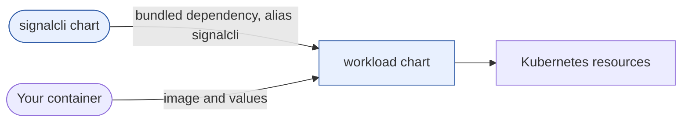

# Helm charts

Public OCI Helm charts for Kubernetes operators: deploy a container with reusable workload
templates, or deploy signal-cli-rest-api with persistent Signal account state.

## Chart Catalogue

| Chart                                   | Latest version | OCI reference                           | Purpose                                                                                                                                                                                     |
| --------------------------------------- | -------------- | --------------------------------------- | ------------------------------------------------------------------------------------------------------------------------------------------------------------------------------------------- |
| [signalcli](charts/signalcli/README.md) | `1.0.5`        | `oci://ghcr.io/f2calv/charts/signalcli` | Deploys [signal-cli-rest-api](https://github.com/bbernhard/signal-cli-rest-api) with persistent account state, compatible probes, JVM-sized resources, and validated environment variables. |
| [workload](charts/workload/README.md)   | `1.5.0`        | `oci://ghcr.io/f2calv/charts/workload`  | Deploys common Kubernetes workload kinds through framework-neutral templates with concise defaults and opt-in operational controls.                                                         |

Browse the public [workload package](https://github.com/f2calv/helm-charts/pkgs/container/charts%2Fworkload)
or [signalcli package](https://github.com/f2calv/helm-charts/pkgs/container/charts%2Fsignalcli).

## Quick Start

With an OCI-capable Helm client and a Kubernetes context, install a single HTTP workload:

```bash
helm install my-app oci://ghcr.io/f2calv/charts/workload --version 1.5.0 \
  --namespace my-namespace --create-namespace \
  --set replicaCount=1 \
  --set-string image.repository=nginx \
  --set-string image.tag=1.27-alpine
```

This creates a Deployment and ClusterIP Service. No Helm repository registration or GHCR login
is required to pull these public charts. Pin the chart version and set your own image tag;
the workload default is zero replicas, not a runnable application.

Use the chart READMEs for Argo CD examples, values, persistence and mode-specific prerequisites.
The signalcli chart additionally needs a default or explicitly selected StorageClass and account
registration/linking after installation.

## Dependency Graph

The signalcli package includes its exact workload dependency; installing it does not require
checking out this repository.



## Version Selection

Each chart has an independent version, defined in
[signalcli Chart.yaml](charts/signalcli/Chart.yaml) and
[workload Chart.yaml](charts/workload/Chart.yaml). OCI tags use the bare chart version;
source release tags use `<chart>/<version>`. A chart version is not its container image version.
The signalcli dependency is pinned in its [Chart.lock](charts/signalcli/Chart.lock).

## License

This project is released under the [MIT License](LICENSE).
