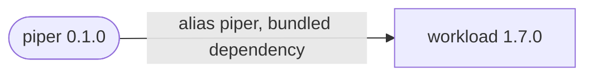

# piper

Deploy [LinuxServer Piper](https://docs.linuxserver.io/images/docker-piper/) as a Wyoming
text-to-speech service with a persistent voice cache and TCP startup/readiness probes.
The chart uses the shared workload chart for Kubernetes configuration.

## Install

Requires Helm 3, Kubernetes, a suitable default StorageClass and outbound access to download the
selected voice on first start. The pinned LinuxServer image supports Linux AMD64 and ARM64.
No GPU or credentials are required by the default configuration.

```bash
helm install piper oci://ghcr.io/f2calv/charts/piper --version 0.1.0 \
  --namespace example-tts --create-namespace
```

No Helm repository registration or registry login is required.

The Service exposes Wyoming TCP on port `10200`, not an HTTP API. With release name `piper` and
default naming, a Wyoming client connects to `piper.example-tts.svc.cluster.local:10200`.
There is no HTTP ingress, web UI or automatic client registration.

For Argo CD, use this Helm source:

```yaml
source:
  repoURL: ghcr.io/f2calv
  chart: charts/piper
  targetRevision: 0.1.0
  helm:
    releaseName: piper
    valuesObject:
      piper:
        envVars:
          PIPER_VOICE: en_US-lessac-medium
```

## Configuration

Everything under `piper` is passed to the workload dependency. The
[values](https://github.com/f2calv/helm-charts/blob/main/charts/piper/values.yaml) and generated
[schema](https://github.com/f2calv/helm-charts/blob/main/charts/piper/values.schema.json)
define the application-specific contract; the
[workload chart](https://github.com/f2calv/helm-charts/blob/workload/1.7.0/charts/workload/README.md)
owns the underlying Kubernetes controls and Secret-reference contract.

| Value | Default | Behavior |
| --- | --- | --- |
| `piper.replicaCount` | `1` | Accepts 0 or 1; zero suppresses Deployment and Service, not the PVC |
| `piper.kind`, `piper.strategy.type` | `Deployment`, `Recreate` | One cache writer; old pod stops before replacement |
| `piper.image.repository`, `piper.image.tag` | `lscr.io/linuxserver/piper`, `2.5.4-ls140` | Pinned LinuxServer Piper image |
| `piper.service.port` | `10200` | Service-facing TCP port; container port remains 10200 |
| `piper.envVars.PIPER_VOICE` | `en_US-lessac-medium` | Non-empty voice identifier, downloaded on first use |
| `piper.envVars.PUID`, `piper.envVars.PGID` | `"1000"`, `"1000"` | LinuxServer application user/group IDs |
| `piper.envVars.TZ` | `Etc/UTC` | Container timezone |
| `piper.startupProbe` | TCP, 60 attempts at 10-second intervals | Approximately ten minutes for initial voice download/startup |
| `piper.readinessProbe` | TCP every 10 seconds | Listener availability, not a synthesis or audio-quality test |
| `piper.livenessProbe` | `false` | Avoids restarting a busy synthesis process |
| `piper.persistentVolumeClaims` | `piper-data`, 1Gi, ReadWriteOnce | Release-owned voice cache mounted at `/config` |
| `piper.resources` | 100m/256Mi requests, 1Gi memory limit | Starting budgets, not measured capacity guarantees |

The chart is configured for the LinuxServer image. Its startup scripts perform initialization before
running Piper under `PUID`/`PGID`; those variables do not mean the whole container starts as non-root.
Do not add `runAsNonRoot` or drop initialization privileges without validating the image's supported
non-root mode and volume permissions.

The schema validates these optional upstream environment settings:

- `PIPER_LENGTH`: positive YAML number; `PIPER_NOISE` and `PIPER_NOISEW`: non-negative YAML numbers.
- `PIPER_SPEAKER`: non-negative integer for a multi-speaker voice.
- `LOCAL_ONLY` and `NO_STREAMING`: omit or set `""` to disable; use `true` to enable.
  LinuxServer treats **any non-empty value**, including `"false"`, as enabled, so false values are
  rejected rather than silently reversing the operator's intent.

Extra environment variables remain open for compatible upstream additions. Voice existence,
timezone names, voice licenses and model capacity are not proven by schema validation.
See the [image parameter documentation](https://docs.linuxserver.io/images/docker-piper/#environment-variables-e).

## Configuration Examples

### Select a Voice

Merge this fragment into the defaults:

```yaml
piper:
  envVars:
    PIPER_VOICE: en_US-lessac-medium
    PIPER_LENGTH: 1.1
```

### Reuse a Prepared Voice Cache

The existing claim must contain the selected voice files in the layout expected by the image,
be writable by the configured user/group and exist in the workload namespace:

```yaml
piper:
  persistentVolumeClaims: []
  volumes:
    - name: voices
      persistentVolumeClaim:
        claimName: existing-voice-cache
  envVars:
    PIPER_VOICE: en_US-lessac-medium
    LOCAL_ONLY: true
    PUID: "2000"
    PGID: "2000"
```

The default mount still connects `voices` to `/config`. Omitting `LOCAL_ONLY` permits downloads.

### Ephemeral Evaluation

```yaml
piper:
  persistentVolumeClaims: []
  volumes:
    - name: voices
      emptyDir: {}
```

Voice downloads are lost when the pod is replaced. Allow enough startup time and storage.

## Persistence and Access

The default claim name `piper-data` is literal, not release-prefixed. For multiple releases in
one namespace, give each release a distinct claim name in both `persistentVolumeClaims` and
`volumes`, or use separate namespaces. Service names use the dependency's normal release naming.
The chart adds no PVC keep policy: plan backup/retention before uninstalling or pruning.

Keep network exposure private and apply deployment-appropriate NetworkPolicies. This chart creates
no authentication credentials or Secrets; existing Secret references and mounts remain available
through workload values. Do not put credentials in chart values.

## Dependency Graph

The package bundles its exact dependency; users do not need a sibling chart checkout to install a
release.


