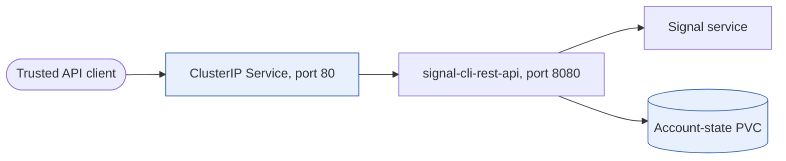

# signalcli

Deploys the [bbernhard/signal-cli-rest-api](https://github.com/bbernhard/signal-cli-rest-api)
container, a REST and JSON-RPC wrapper around [signal-cli](https://github.com/AsamK/signal-cli).

This chart supplies a volume for account state, probes that match what the image exposes, resources sized for
a JVM, and schema validation of the environment variables that change its behaviour.

The chart depends on the sibling
[`workload`](https://github.com/f2calv/helm-charts/blob/main/charts/workload/README.md) chart at an exact version and
bundles that dependency into every published package. Everything under `signalcli` is passed to
that subchart, so its keys are the workload chart's keys.

## Install

Requires an OCI-capable Helm client, a Kubernetes cluster and a default StorageClass (or an explicit
class in your values). Public GHCR pulls do not require a login. Installation starts the API but
does not register or link a Signal account.

The default Service and PVC names are fixed (`signalcli` and `signalcli-pvc`). For multiple releases
in one namespace, override `signalcli.fullnameOverride`, the claim name and its volume reference
together; changing only the Helm release name does not isolate them.

### Helm

Install the application-specific `signalcli` chart directly from GHCR:

```bash
helm install signalcli oci://ghcr.io/f2calv/charts/signalcli --version 1.1.0 \
  --namespace my-namespace --create-namespace \
  --set-string signalcli.envVars.MODE=json-rpc \
  --set-string signalcli.envVars.LOG_LEVEL=info
```

Upgrade to the latest stable `signalcli` chart published in GHCR:

```bash
helm upgrade --install signalcli oci://ghcr.io/f2calv/charts/signalcli \
  --namespace my-namespace --create-namespace \
  --set-string signalcli.envVars.MODE=json-rpc \
  --set-string signalcli.envVars.LOG_LEVEL=info
```

### Argo CD Application

[Argo CD](https://argo-cd.readthedocs.io/) can consume the same OCI package directly:

```yaml
apiVersion: argoproj.io/v1alpha1
kind: Application
metadata:
  name: signalcli
  namespace: argocd
spec:
  project: default
  destination:
    namespace: my-namespace
    server: https://kubernetes.default.svc
  source:
    repoURL: ghcr.io/f2calv
    chart: charts/signalcli
    targetRevision: 1.1.0
    helm:
      valuesObject:
        signalcli:
          envVars:
            MODE: json-rpc
            LOG_LEVEL: info
  syncPolicy:
    automated:
      prune: true
      selfHeal: true
    syncOptions:
      - CreateNamespace=true
```

## Setup

The container is useless until a Signal account is
registered or linked to it, and that state must land on the persistent volume.

1. Port-forward the service:

   ```bash
    kubectl port-forward --namespace my-namespace svc/signalcli 8080:80
   ```

2. Link as a secondary device to an existing Signal account — the simpler route:

   ```bash
   curl 'http://localhost:8080/v1/qrcodelink?device_name=signalcli'
   ```

   That returns a QR code image. Scan it from Signal on your phone under
   **Settings → Linked devices**.

3. Or register the number outright, which requires solving a captcha and receiving an SMS or voice
   code. See the upstream documentation, as the captcha flow changes periodically.

4. Confirm the account is registered:

   ```bash
   curl http://localhost:8080/v1/accounts
   ```

Account state is written to `/home/.local/share/signal-cli`. If that path is not backed by a
volume, every restart discards the registration and you start again.

## Configuration

The [`signalcli` values](https://github.com/f2calv/helm-charts/blob/main/charts/signalcli/values.yaml)
override the bundled workload chart. Its generated
[schema](https://github.com/f2calv/helm-charts/blob/main/charts/signalcli/values.schema.json)
validates the declared environment settings; open-ended extra variables still need upstream verification.

| Value | Default | Notes |
| --- | --- | --- |
| [`signalcli.replicaCount`](https://github.com/f2calv/helm-charts/blob/main/charts/signalcli/values.yaml) | `1` | Capped at one because one registered device owns one state volume |
| [`signalcli.strategy.type`](https://github.com/f2calv/helm-charts/blob/main/charts/signalcli/values.yaml) | `Recreate` | The old pod releases the account lock before the new one starts |
| [`signalcli.image.tag`](https://github.com/f2calv/helm-charts/blob/main/charts/signalcli/values.yaml) | `0.101` | Pinned because an empty tag falls back to the workload chart's `appVersion` |
| [`signalcli.envVars.MODE`](https://github.com/f2calv/helm-charts/blob/main/charts/signalcli/values.yaml) | `json-rpc` | Also decides the receive endpoint's shape |
| [`signalcli.envVars.LOG_LEVEL`](https://github.com/f2calv/helm-charts/blob/main/charts/signalcli/values.yaml) | `info` | |
| [`signalcli.startupProbe`](https://github.com/f2calv/helm-charts/blob/main/charts/signalcli/values.yaml) | `/v1/about` | Approximately five minutes of startup allowance, plus the initial delay |
| [`signalcli.readinessProbe`](https://github.com/f2calv/helm-charts/blob/main/charts/signalcli/values.yaml) | `/v1/about` | Marks the pod ready when it can serve requests |
| [`signalcli.livenessProbe`](https://github.com/f2calv/helm-charts/blob/main/charts/signalcli/values.yaml) | `false` | Avoids restarting a slow or busy JVM and disconnecting clients |
| [`signalcli.persistentVolumeClaims`](https://github.com/f2calv/helm-charts/blob/main/charts/signalcli/values.yaml) | 512Mi `ReadWriteOnce` | For ephemeral use, clear claims, volumes and mounts together |

Environment variables keep their upstream names verbatim, so each traces directly back to the
[bbernhard documentation](https://github.com/bbernhard/signal-cli-rest-api). The map stays
**open**: a variable added by a newer image release can be
set immediately, without waiting for a chart release. The declared variables below are
validated, so an invalid declared value fails the install rather than the pod:

```text
Error: values don't meet the specifications of the schema(s) in the following chart(s):
- at '/signalcli/envVars/MODE': value must be one of 'normal', 'native', 'json-rpc', 'json-rpc-native'
```

### Validated environment variables

These names and constraints are declared in
[`signalcli.envVars`](https://github.com/f2calv/helm-charts/blob/main/charts/signalcli/values.yaml).
The upstream-default column describes the image, not extra values injected by this chart.

| Variable | Accepted | Upstream default |
| --- | --- | --- |
| `MODE` | `normal`, `native`, `json-rpc`, `json-rpc-native` | `normal` |
| `AUTO_RECEIVE_SCHEDULE` | five non-empty whitespace-separated fields; image interprets cron syntax | unset |
| `LOG_LEVEL` | `debug`, `info`, `warn`, `error` | `info` |
| `DEFAULT_SIGNAL_TEXT_MODE` | `normal`, `styled` | `normal` |
| `PORT` | 1–65535 | `8080` |
| `SIGNAL_CLI_CONFIG_DIR` | absolute path | `/home/.local/share/signal-cli/` |
| `SIGNAL_CLI_UID` | unsigned integer | `1000` |
| `SIGNAL_CLI_GID` | unsigned integer | `1000` |
| `SIGNAL_CLI_CHOWN_ON_STARTUP` | boolean | `true` |
| `JSON_RPC_IGNORE_ATTACHMENTS` | boolean | `false` |
| `JSON_RPC_IGNORE_STORIES` | boolean | `false` |
| `JSON_RPC_IGNORE_AVATARS` | boolean | `false` |
| `JSON_RPC_IGNORE_STICKERS` | boolean | `false` |
| `JSON_RPC_TRUST_NEW_IDENTITIES` | `on-first-use`, `always`, `never` | `on-first-use` |
| `SWAGGER_HOST` | non-empty string | `SWAGGER_IP:PORT` |
| `SWAGGER_IP` | non-empty string | container IP |
| `SWAGGER_USE_HTTPS_AS_PREFERRED_SCHEME` | boolean | `false` |

Booleans accept either YAML form, `true` or `"true"`, because the workload chart quotes every value
before it reaches the container. The same applies to the numeric variables.

Three of these are not independent, and the schema cannot enforce that for you:

- **`PORT`** is addressed directly by `service.containerPort` and by both probes. Change it alone
  and the service routes nowhere while the probes fail the pod.
- **`SIGNAL_CLI_CONFIG_DIR`** must match `volumeMounts[0].mountPath`. Change it alone and the
  registration is written outside the volume, so it survives until the next restart and no longer.
- **`AUTO_RECEIVE_SCHEDULE`** applies to `normal` and `native` mode only, and must not be set while
  anything reads messages through the API. `receive` drains the queue from the Signal server, so
  whichever caller arrives second gets nothing.

### Default Values

```yaml
signalcli:
  # Resource naming and workload size.
  fullnameOverride: signalcli
  replicaCount: 1
  strategy:
    type: Recreate

  # Container image and service.
  image:
    repository: bbernhard/signal-cli-rest-api
    pullPolicy: IfNotPresent
    tag: "0.101"
  service:
    enabled: true
    name: http
    type: ClusterIP
    port: 80
    containerPort: 8080
    protocol: TCP

  # Application environment.
  envVars:
    MODE: json-rpc
    LOG_LEVEL: info

  # Startup and readiness checks.
  startupProbe:
    httpGet:
      path: /v1/about
      port: 8080
    periodSeconds: 10
    initialDelaySeconds: 15
    failureThreshold: 30
  readinessProbe:
    httpGet:
      path: /v1/about
      port: 8080
    periodSeconds: 20
    failureThreshold: 3
  livenessProbe: false

  # CPU and memory reservations and limits.
  resources:
    requests:
      cpu: 250m
      memory: 256Mi
    limits:
      cpu: 2000m
      memory: 768Mi

  # Persistent account state.
  volumes:
    - name: data
      persistentVolumeClaim:
        claimName: signalcli-pvc
  volumeMounts:
    - name: data
      mountPath: /home/.local/share/signal-cli
  persistentVolumeClaims:
    - name: signalcli-pvc
      accessModes:
        - ReadWriteOnce
      storage: 512Mi
```

## Persistence

The default request is 512Mi. Size it for your account's data, attachments, avatars and stickers;
the chart does not enforce a retention limit. PVCs cannot be shrunk. Set
`JSON_RPC_IGNORE_STICKERS: true` if sticker downloads are unnecessary.

`storageClassName` is left unset so a clean install works anywhere, which means the cluster default
is used. **Set it explicitly for anything you intend to keep.** A cluster can carry more than one
default StorageClass, in which case the most recently created one wins, and you can silently land
on a class that is neither replicated nor expandable. Set it through Helm:

```bash
helm upgrade --install signalcli oci://ghcr.io/f2calv/charts/signalcli \
  --namespace my-namespace --create-namespace \
  --set-string 'signalcli.persistentVolumeClaims[0].name=signalcli-pvc' \
  --set-string 'signalcli.persistentVolumeClaims[0].accessModes[0]=ReadWriteOnce' \
  --set-string 'signalcli.persistentVolumeClaims[0].storage=512Mi' \
  --set-string 'signalcli.persistentVolumeClaims[0].storageClassName=longhorn'
```

Or set the same values via Argo CD manifest:

```yaml
signalcli:
  persistentVolumeClaims:
    - name: signalcli-pvc
      accessModes:
        - ReadWriteOnce
      storage: 512Mi
      storageClassName: longhorn
```

To grow the volume later, raise `storage` in your values and let the release reconcile. Never edit
the PVC directly: under a GitOps controller with self-heal the change is reverted, and because a
PVC cannot shrink the resource is then stuck permanently out of sync. Growing at all requires a
StorageClass with `allowVolumeExpansion: true`.

### Ephemeral installs

The volume can be removed entirely for a throwaway evaluation, at the cost of re-registering the
account after every restart. There is no `persistence.enabled` toggle, because the storage values
are consumed by a subchart and Helm resolves subchart values before templating, so the chart cannot
conditionally remove them. Clear all three lists instead (`--set-json` requires Helm 3.10 or newer):

```bash
helm upgrade --install signalcli oci://ghcr.io/f2calv/charts/signalcli \
  --namespace my-namespace --create-namespace \
  --set-json 'signalcli.volumes=[]' \
  --set-json 'signalcli.volumeMounts=[]' \
  --set-json 'signalcli.persistentVolumeClaims=[]'
```

Or set the same values via an Argo CD manifest:

```yaml
signalcli:
  volumes: []
  volumeMounts: []
  persistentVolumeClaims: []
```

### Moving an account between volumes

The registration is ordinary files, so it can be copied into a new claim. Scale down first: the
message database is a live SQLite file and copying it from under a running JVM can capture a torn
write. The copy example assumes a separately created helper pod mounting the stopped account's claim;
the chart does not create that helper.

```bash
kubectl scale --namespace my-namespace deployment/signalcli --replicas=0
kubectl cp --namespace my-namespace <helper-pod>:/home/.local/share/signal-cli ./signal-cli-backup
```

The account JSON holds the device's private keys. Treat the copy as a credential: it is enough to
impersonate the linked device. Note also that Signal's double ratchet advances with every message,
so restoring a *stale* copy over an account that has kept running leaves the session desynchronised
and messages undecryptable — restore the most recent state, or re-link the device instead.

## Upgrading

### 1.1.0

The default image moves from signal-cli-rest-api 0.100 to 0.101 (signal-cli 0.14.8). The chart
values are unchanged, but the API and logging behaviour are not:

- `POST /v2/send` returns an array with one entry per recipient type instead of a single object.
  Each entry carries the `timestamp` and, when some recipients could not be reached, an `errors`
  object. Update clients that parse the send response before upgrading.
- In `json-rpc` mode signal-cli now writes its plain-text output to the container log, including
  every received envelope with the sender, their number and the message text. Exclude the container
  from log collection if its logs leave the cluster.
- Upstream merged the rootless image into the single published image.

To stay on 0.100 temporarily, set `signalcli.image.tag: "0.100"`.

## Related Projects

See the [chart dependency declaration](https://github.com/f2calv/helm-charts/blob/main/charts/signalcli/Chart.yaml)
and [locked workload version](https://github.com/f2calv/helm-charts/blob/main/charts/signalcli/Chart.lock)
for the packaged dependency contract.

- [Kubernetes](https://kubernetes.io/) provides the workload resources rendered by this chart.
- [bbernhard/signal-cli-rest-api](https://github.com/bbernhard/signal-cli-rest-api)
- [CasCap.Api.SignalCli](https://github.com/f2calv/CasCap.Api.SignalCli) provides typed .NET clients
  for the REST and JSON-RPC APIs.
- [signalizr](https://github.com/f2calv/signalizr) provides a controlled Signal gateway for
  applications that should not own an account connection directly.

## Data Flow

The workload subchart creates the Service, Deployment and account-state PVC. Register or link
through the API after installation; neither the chart nor the volume registers an account for you.
Keep the API private to trusted clients: chart defaults do not add authentication or TLS.



This diagram is supplemental; chart registry renderers may not render Mermaid.

## License

[MIT License](https://github.com/f2calv/helm-charts/blob/main/LICENSE).
