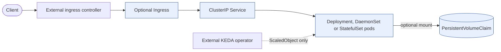

# workload

Deploy common Kubernetes workload kinds through one framework-neutral Helm chart. Container
application operators supply the image and runtime configuration; the chart supplies Kubernetes resources.

`workload` is a universal, framework-neutral Helm chart for deploying one
containerised workload without maintaining a large application-specific chart.
Sensible defaults keep common deployments concise, while explicit values expose
the Kubernetes controls needed for stateful services, background jobs,
autoscaling, scheduling, networking, storage, and disruption management.

The same chart supports .NET, Go, Rust, Java, and other containerised runtimes.
Applications supply their image and runtime-specific configuration; the chart
owns the reusable Kubernetes resource structure.

## Install

Requires an OCI-capable Helm client and a Kubernetes cluster supporting the selected resource APIs.
Public GHCR pulls do not need a login. KEDA modes require KEDA and its CRDs to be installed separately;
Ingress needs a matching controller, and persistent claims need a suitable storage provisioner.

### Helm

Install the `workload` chart directly from GHCR:

```bash
helm install my-app oci://ghcr.io/f2calv/charts/workload --version 1.6.0 \
  --namespace my-namespace --create-namespace \
  --set replicaCount=1 \
  --set-string image.repository=nginx \
  --set-string image.tag=1.27-alpine
```

Upgrade to the latest stable `workload` chart published in GHCR:

```bash
helm upgrade --install my-app oci://ghcr.io/f2calv/charts/workload \
  --namespace my-namespace --create-namespace \
  --set replicaCount=1 \
  --set-string image.repository=nginx \
  --set-string image.tag=1.27-alpine
```

### Argo CD Application

[Argo CD](https://argo-cd.readthedocs.io/) can consume the same OCI package directly:

```yaml
apiVersion: argoproj.io/v1alpha1
kind: Application
metadata:
  name: my-app
  namespace: argocd
spec:
  project: default
  destination:
    namespace: my-namespace
    server: https://kubernetes.default.svc
  source:
    repoURL: ghcr.io/f2calv
    chart: charts/workload
    targetRevision: 1.6.0
    helm:
      valuesObject:
        replicaCount: 1
        image:
          repository: nginx
          tag: 1.27-alpine
  syncPolicy:
    automated:
      prune: true
      selfHeal: true
    syncOptions:
      - CreateNamespace=true
```

## Configuration

The public values contract is defined in
[values.yaml](https://github.com/f2calv/helm-charts/blob/main/charts/workload/values.yaml)
and validated by the generated
[values.schema.json](https://github.com/f2calv/helm-charts/blob/main/charts/workload/values.schema.json).
The schema does not prove that arbitrary Kubernetes objects or controller-specific settings are valid.

### Behavior and Limits

- [`replicaCount`](https://github.com/f2calv/helm-charts/blob/main/charts/workload/templates/deployment.yaml)
  defaults to `0`: Deployment, DaemonSet and StatefulSet output is suppressed, including the Deployment
  used by ScaledObject. Their Service is also suppressed. This is **not** a release-wide off switch:
  Ingress, storage, configuration, policies and KEDA resources have separate conditions.
- [`image.tag`](https://github.com/f2calv/helm-charts/blob/main/charts/workload/templates/deployment.yaml)
  falls back to `appVersion` (`1.1.0`), not a tag inferred from your image. Supply a real image tag.
  The `app.kubernetes.io/version` label uses the same resolved tag, without any `@sha256` digest.
- [`autoscaling.enabled`](https://github.com/f2calv/helm-charts/blob/main/charts/workload/templates/deployment.yaml)
  only omits `spec.replicas`; it does not create a HorizontalPodAutoscaler.
- [`kind`](https://github.com/f2calv/helm-charts/blob/main/charts/workload/values.yaml)
  selects one primary workload mode. Job, CronJob and ScaledJob do not receive a Service or Ingress.
  CronJob requires `cronJobSchedule`; configure KEDA triggers for either KEDA mode.
- [`persistentVolumeClaims`](https://github.com/f2calv/helm-charts/blob/main/charts/workload/templates/pvc.yaml)
  uses the exact supplied claim names, without release prefixes. Choose unique names across releases
  and plan deletion/data retention separately; the chart does not add a keep policy.
- [`podDisruptionBudget`](https://github.com/f2calv/helm-charts/blob/main/charts/workload/templates/poddisruptionbudget.yaml)
  requires a long-running mode and positive replicas. Exactly one of `minAvailable` or `maxUnavailable`
  must be set: set the default `minAvailable` to `null` before supplying `maxUnavailable`.
- Probes, `lifecycle`, `extraContainers`, `hostNetwork`, `dnsPolicy` and
  `terminationGracePeriodSeconds` are rendered only by the
  [long-running workload template](https://github.com/f2calv/helm-charts/blob/main/charts/workload/templates/deployment.yaml),
  not Job, CronJob or ScaledJob. Those modes still share image, environment, mounts, resources and
  scheduling. Job and CronJob use `job` limits; ScaledJob uses `keda.jobTargetRef`.

### Workload Kinds

Set `kind` to one of the supported primary workload modes (subject to the replica guard above):

`Deployment` is the default.

| Value | Resources rendered | Description |
| --- | --- | --- |
| [`Deployment`](https://github.com/f2calv/helm-charts/blob/main/charts/workload/templates/deployment.yaml) | Deployment | Runs scalable, interchangeable pods with rolling updates. |
| [`DaemonSet`](https://github.com/f2calv/helm-charts/blob/main/charts/workload/templates/deployment.yaml) | DaemonSet | Runs one pod on every eligible node. |
| [`StatefulSet`](https://github.com/f2calv/helm-charts/blob/main/charts/workload/templates/deployment.yaml) | StatefulSet | Runs ordered pods with stable identities and storage. |
| [`Job`](https://github.com/f2calv/helm-charts/blob/main/charts/workload/templates/job.yaml) | Job | Runs a one-shot task to completion. |
| [`ScaledObject`](https://github.com/f2calv/helm-charts/blob/main/charts/workload/templates/scaledobject.yaml) | Deployment and KEDA ScaledObject | Adds event-driven autoscaling to a Deployment. |
| [`CronJob`](https://github.com/f2calv/helm-charts/blob/main/charts/workload/templates/cronjob.yaml) | CronJob | Runs a workload on a repeating schedule. |
| [`ScaledJob`](https://github.com/f2calv/helm-charts/blob/main/charts/workload/templates/scaledjob.yaml) | KEDA ScaledJob | Creates event-driven Jobs that scale with queue demand. |

Set `kind: Job` to render a one-shot Job using the shared image, environment,
volumes, resources, and scheduling configuration.

### Computed Ingress Annotations

Use [`computedAnnotations`](https://github.com/f2calv/helm-charts/blob/main/charts/workload/templates/_helpers.tpl)
when an ingress controller annotation must reference the
Service name rendered by this chart. The chart resolves the value after applying
the release name, dependency alias, `nameOverride`, and `fullnameOverride`.

```yaml
service:
  port: 5001
  containerPort: 5001
ingress:
  enabled: true
  className: nginx-f5
  annotations:
    nginx.org/mergeable-ingress-type: minion
  computedAnnotations:
    nginx.org/grpc-services:
      valueFrom: serviceName
  servicePort: 5001
  hosts:
    - host: grpc.example.com
      paths:
        - path: /example.Service
          pathType: ImplementationSpecific
```

This renders `nginx.org/grpc-services` with the exact Service name used by the
Ingress backend. The same contract applies to entries under `extraIngresses`.
An annotation key cannot appear in both `annotations` and
`computedAnnotations`; conflicting configuration fails rendering.

This is an override fragment for an application already listening on port 5001, with a matching
F5 NGINX controller. Select that application's image separately.

### Environment Variables

Use [`envVars`](https://github.com/f2calv/helm-charts/blob/main/charts/workload/templates/_helpers.tpl)
for literal scalars,
[`envVarsValueFrom`](https://github.com/f2calv/helm-charts/blob/main/charts/workload/templates/_helpers.tpl)
for individual Kubernetes references, and
[`envVarsFrom`](https://github.com/f2calv/helm-charts/blob/main/charts/workload/templates/_helpers.tpl)
for complete ConfigMap or Secret imports.
[`envFieldRef`](https://github.com/f2calv/helm-charts/blob/main/charts/workload/templates/_helpers.tpl)
is a concise downward-API shorthand, while
[`envSecrets`](https://github.com/f2calv/helm-charts/blob/main/charts/workload/templates/_helpers.tpl) maps
an environment variable to a Secret of the same key name.

```yaml
envVars:
  LOG_LEVEL: Information
envVarsValueFrom:
  DATABASE_PASSWORD:
    secretKeyRef:
      name: database
      key: password
  NODE_NAME:
    fieldRef:
      fieldPath: spec.nodeName
envVarsFrom:
  - prefix: SHARED_
    configMapRef:
      name: shared-settings
  - secretRef:
      name: shared-secrets
```

Variable names must be unique across `envFieldRef`, `envVars`, `envSecrets`,
and `envVarsValueFrom`; conflicting declarations fail rendering.

### Network Policies

Declare workload-owned policies through
[`networkPolicies`](https://github.com/f2calv/helm-charts/blob/main/charts/workload/templates/networkpolicy.yaml).
Each entry requires a
name and a Kubernetes `NetworkPolicySpec`; labels and annotations are optional.

```yaml
networkPolicies:
  - name: allow-ingress
    spec:
      podSelector:
        matchLabels:
          app.kubernetes.io/name: workload
          app.kubernetes.io/instance: my-app
      policyTypes:
        - Ingress
      ingress:
        - from:
            - namespaceSelector:
                matchLabels:
                  kubernetes.io/metadata.name: ingress-system
```

Keep a policy outside the release only when it spans releases or requires an
independent lifecycle or sync order.

### Persistence

Declare PVCs alongside their consuming workload through `persistentVolumeClaims`.
Each claim requires a name, one or more Kubernetes access modes, and a storage
capacity. `storageClassName` is optional so clusters can use their default class.

Set the values through the Helm CLI:

```bash
helm upgrade --install my-app oci://ghcr.io/f2calv/charts/workload \
  --namespace my-namespace --create-namespace \
  --set replicaCount=1 \
  --set-string image.repository=nginx \
  --set-string image.tag=1.27-alpine \
  --set-string 'persistentVolumeClaims[0].name=model-cache' \
  --set-string 'persistentVolumeClaims[0].storageClassName=local-path' \
  --set-string 'persistentVolumeClaims[0].accessModes[0]=ReadWriteOnce' \
  --set-string 'persistentVolumeClaims[0].storage=50Gi' \
  --set-string 'volumes[0].name=models' \
  --set-string 'volumes[0].persistentVolumeClaim.claimName=model-cache' \
  --set-string 'volumeMounts[0].name=models' \
  --set-string 'volumeMounts[0].mountPath=/models'
```

Or set the same values via an Argo CD `valuesObject`:

```yaml
persistentVolumeClaims:
  - name: model-cache
    storageClassName: local-path
    accessModes:
      - ReadWriteOnce
    storage: 50Gi
volumes:
  - name: models
    persistentVolumeClaim:
      claimName: model-cache
volumeMounts:
  - name: models
    mountPath: /models
```

When migrating an existing claim from another GitOps owner, protect the live
resource from pruning and reconcile that protection before transferring the
declaration. Verify the claim UID and bound PV remain unchanged after adoption.

### Default Values

The following defaults mirror the values file. Merge only the overrides you need; an empty image tag
and zero replicas are intentionally unsuitable for the HTTP installation shown above.

```yaml
# Workload mode and replica behavior.
replicaCount: 0
kind: Deployment
namespaceOverride: ""
serviceName: ""
revisionHistoryLimit: 3
strategy: {}
updateStrategy: {}
volumeClaimTemplates: []
cronJobSchedule: ""
cronJobConcurrencyPolicy: Replace
cronJobStartingDeadlineSeconds: null
cronJobSuccessfulJobsHistoryLimit: 3
cronJobFailedJobsHistoryLimit: 1

# Pod execution settings.
restartPolicy: ""
runtimeClassName: ""
hostNetwork: false
dnsPolicy: ""
automountServiceAccountToken: null
terminationGracePeriodSeconds: null

# Container image and process.
image:
  repository: busybox
  pullPolicy: IfNotPresent
  tag: ""
imagePullSecrets: []
command: []
args: []
containerName: ""

# Resource naming and pod identity.
nameOverride: ""
fullnameOverride: ""
commonLabels: {}
serviceAccount:
  create: false
  automount: true
  annotations: {}
  name: ""
podAnnotations: {}
podLabels: {}
podSecurityContext: {}
securityContext: {}

# Service and ingress networking.
service:
  enabled: true
  name: http
  type: ClusterIP
  port: 80
  containerPort: 80
  protocol: TCP
  annotations: {}
extraPorts: []
ingress:
  enabled: false
  className: ""
  annotations: {}
  computedAnnotations: {}
  servicePort: ""
  hosts:
    - host: example.local
      paths:
        - path: /
          pathType: ImplementationSpecific
  tls: []
extraIngresses: []

# Resources, probes, and lifecycle.
resources: {}
startupProbe: false
readinessProbe: false
livenessProbe: false
lifecycle: {}

# Autoscaling and additional containers.
autoscaling:
  enabled: false
initContainers: []
extraContainers: []

# Storage and pod scheduling.
volumes: []
volumeMounts: []
persistentVolumeClaims: []
configMaps: []
networkPolicies: []
nodeSelector: {}
tolerations: []
affinity: {}
topologySpreadConstraints: []

# Pod disruption budget.
podDisruptionBudget:
  enabled: false
  minAvailable: 1
  maxUnavailable: null
  unhealthyPodEvictionPolicy: ""

# Container environment.
envFieldRef: {}
envVars: {}
envSecrets: {}
envVarsValueFrom: {}
envVarsFrom: []

# Job resource settings used when kind is Job.
job:
  annotations: {}
  ttlSecondsAfterFinished: 360
  backoffLimit: 1
  activeDeadlineSeconds: null

# KEDA settings for ScaledObject and ScaledJob workloads.
keda:
  pollingInterval: 10
  cooldownPeriod: 300
  minReplicaCount: 1
  maxReplicaCount: 2
  databaseIndex: ""
  successfulJobsHistoryLimit: 5
  failedJobsHistoryLimit: 5
  rolloutStrategy: gradual
  jobTargetRef:
    activeDeadlineSeconds: 600
    backoffLimit: 6
  triggers: []
  triggerAuthentications: []
```

## Related Projects

- [Kubernetes](https://kubernetes.io/) provides the workload resources rendered by this chart.
- [KEDA](https://keda.sh/) provides the `ScaledObject` and `ScaledJob` autoscaling resources.

## Service Architecture

This shows the HTTP service path, not the Job/CronJob modes. Your image and values supply the
application; the chart creates neither an ingress controller nor a storage provisioner.



The Service follows `service.type`; ClusterIP is the default. See the behavior limits for
replica guards. This diagram supplements the text for renderers without Mermaid support.

## License

[MIT License](https://github.com/f2calv/helm-charts/blob/main/LICENSE).
